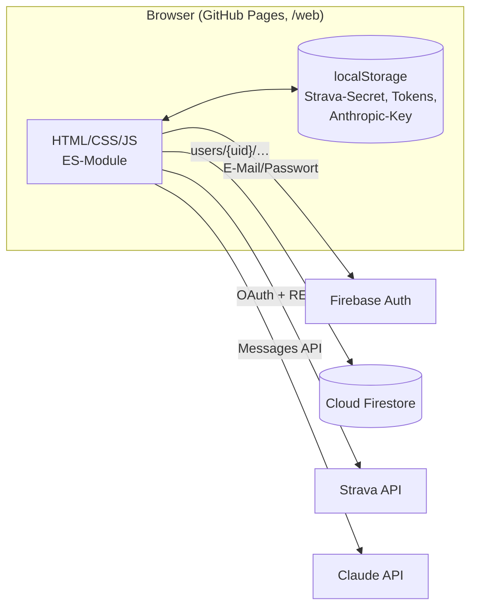

# TPA – persönlicher Trainingsplaner

Eine Web-App nur für mich: Sie verbindet sich mit Strava, analysiert meine Aktivitäten und lässt
mit der Claude API Trainingsempfehlungen und einen Trainingsplan erstellen.

> **Stand:** Grundgerüst. Navigation, Login (E-Mail/Passwort) und die Einstellungsseite funktionieren,
> alles andere sind Platzhalter mit `TODO`-Kommentaren.

## Architektur



- **Frontend:** reines HTML, CSS und JavaScript mit ES-Modulen. Kein Framework, kein Build, kein npm.
  GitHub Pages liefert den Ordner `/web` 1:1 aus.
- **Firebase (Spark-Tarif, kostenlos):** Authentication (E-Mail/Passwort) und Cloud Firestore.
  Das SDK wird per CDN von `gstatic.com` mit fester Version (`13.2.0`) geladen.
- **Kein eigenes Backend:** Cloud Functions bräuchten den kostenpflichtigen Blaze-Tarif. Da die App
  nur von mir genutzt wird, werden Strava und Claude direkt aus dem Browser angesprochen.
  Der Preis dafür: Geheimnisse müssen im Browser liegen (siehe Sicherheitshinweise).

### Dateien

| Pfad | Zweck |
| --- | --- |
| `web/index.html` | Einstieg, Navigation |
| `web/css/style.css` | schlichtes, responsives Layout |
| `web/js/app.js` | Hash-Router, Login-Status, Erkennung der Strava-Rückleitung |
| `web/js/firebase-config.js` | öffentliche Firebase-Konfiguration |
| `web/js/firebase.js` | Firebase-Initialisierung, Login/Logout |
| `web/js/settings.js` | Schlüssel in localStorage lesen, speichern, löschen |
| `web/js/strava.js` | Gerüst: OAuth, Token-Refresh, Aktivitäten laden |
| `web/js/claude.js` | Gerüst: Claude Messages API, Modell- und Prompt-Konstanten |
| `web/js/views/*.js` | je ein Modul pro Seite |
| `firestore.rules` | Security Rules zum Einfügen in der Firebase-Konsole |
| `.github/workflows/deploy-pages.yml` | Deployment von `/web` auf GitHub Pages |

### Seiten (Hash-Routing)

`#login` · `#verbinden` · `#aktivitaeten` · `#analyse` · `#plan` · `#einstellungen`

### Firestore-Datenmodell (geplant)

```
users/{uid}
users/{uid}/activities/{activityId}   normalisierte Strava-Aktivitäten
users/{uid}/analyses/{analysisId}     Auswertungen und Claude-Empfehlungen
users/{uid}/plans/{planId}            Trainingspläne
```

Jeder Nutzer darf nur unter `users/{uid}/…` lesen und schreiben, alles andere ist gesperrt.

## Sicherheitshinweise

- **Niemals ins Repository:** Strava Client Secret, Strava Access-/Refresh-Tokens, Anthropic-API-Key.
- Diese Werte werden auf der Seite **Einstellungen** eingegeben und **nur im localStorage dieses
  Browsers** gespeichert – nicht im Code und nicht in Firestore.
- Der Button **„Alle Schlüssel löschen“** entfernt sie wieder (z. B. vor dem Abmelden auf einem
  fremden Gerät). Die App am besten nur auf eigenen Geräten verwenden.
- localStorage ist für jedes Skript auf der Seite lesbar. Deshalb: keine fremden Skripte einbinden
  (außer dem Firebase-SDK mit fester Version), Nutzereingaben und API-Antworten nie als HTML
  einsetzen (`textContent` statt `innerHTML`).
- Das Strava Client Secret im Browser ist ein bewusster Kompromiss, weil es keinen Server gibt.
  Bei Verdacht auf Missbrauch das Secret in den Strava-API-Einstellungen neu erzeugen.
- Claude-Aufrufe aus dem Browser benötigen den Header
  `anthropic-dangerous-direct-browser-access: true`. **Unbedingt ein Ausgabelimit** für den
  API-Key in der Anthropic-Konsole setzen.
- Die Firebase-Web-Konfiguration (`apiKey`, `projectId` …) ist öffentlich und darf ins Repository.
  Geschützt werden die Daten durch Login und `firestore.rules`.

## Einrichtung Schritt für Schritt

Die App läuft später unter `https://jakobschiller34-jpg.github.io/TPA-Schiller/`.

### 1. Firebase-Projekt anlegen

1. In der [Firebase-Konsole](https://console.firebase.google.com/) ein neues Projekt anlegen
   (Google Analytics wird nicht benötigt). Tarif: **Spark** (kostenlos).
2. **Authentication → Sign-in method → E-Mail-Adresse/Passwort** aktivieren
   (nur die erste Option, „E-Mail-Link“ wird nicht benötigt).
   Dann unter **Authentication → Users → Nutzer hinzufügen** das eigene Konto mit E-Mail und
   Passwort anlegen. Eine Registrierung in der App gibt es bewusst nicht.
   Empfehlung: **Authentication → Einstellungen → Nutzeraktionen** → „Erstellen (Registrierung)
   aktivieren“ ausschalten, damit sich niemand sonst über die API ein Konto anlegen kann.
3. **Authentication → Einstellungen → Autorisierte Domains:**
   `jakobschiller34-jpg.github.io` hinzufügen. `localhost` ist standardmäßig eingetragen.
   (Hinweis: `127.0.0.1` ist nicht automatisch dabei – lokal also `localhost` verwenden
   oder `127.0.0.1` zusätzlich eintragen.)
4. **Firestore Database → Datenbank erstellen**, Modus „Produktion“, Standort z. B.
   `eur3` oder `europe-west3` (der Standort lässt sich später nicht ändern).
5. **Projekteinstellungen → Allgemein → Meine Apps → Web-App hinzufügen** (ohne Firebase Hosting)
   und die angezeigten Werte in `web/js/firebase-config.js` eintragen.

### 2. Security Rules einfügen

Firestore Database → **Regeln** → den Inhalt von [`firestore.rules`](firestore.rules) einfügen →
**Veröffentlichen**.

### 3. Strava-API-App anlegen

1. Unter <https://www.strava.com/settings/api> eine App anlegen.
2. **Authorization Callback Domain:** `jakobschiller34-jpg.github.io` (nur die Domain, ohne
   `https://` und ohne Pfad). Für lokale Tests akzeptiert Strava auch `localhost`; die Domain
   muss dann vorübergehend umgestellt werden.
3. **Client ID** und **Client Secret** notieren und später in der App unter
   **Einstellungen** eintragen – nicht im Code.

### 4. Anthropic-API-Key erstellen

1. In der [Claude Console](https://console.anthropic.com/) einen API-Key erstellen.
2. Unter Limits ein **monatliches Ausgabelimit** setzen (z. B. wenige Euro).
3. Den Key in der App unter **Einstellungen** eintragen.

### 5. GitHub Pages aktivieren

1. Repository → **Settings → Pages → Build and deployment → Source: „GitHub Actions“**.
2. Nach einem Push auf `main` läuft der Workflow `Deploy to GitHub Pages` und veröffentlicht `/web`.
   Er lässt sich auch manuell unter **Actions** starten.

### 6. Lokal testen

Die App braucht einen statischen Webserver (ES-Module funktionieren nicht über `file://`):

- **VS Code:** Erweiterung „Live Server“ installieren, `web/index.html` öffnen →
  „Open with Live Server“. Im Browser `localhost` statt `127.0.0.1` verwenden (siehe Schritt 1).
- **Alternativ mit Python:** im Ordner `web` `python -m http.server 8000` ausführen und
  <http://localhost:8000/> öffnen.

Ohne eingetragene Firebase-Konfiguration lässt sich trotzdem navigieren; die Login-Seite zeigt dann
den Hinweis „Firebase ist noch nicht konfiguriert“.

## Offene Punkte und nächste Ausbaustufen

1. **CORS-Test Strava-Token-Tausch:** Prüfen, ob `POST https://www.strava.com/oauth/token`
   direkt aus dem Browser funktioniert. Falls nicht, braucht es doch einen kleinen Proxy
   (z. B. Cloudflare Worker) oder Cloud Functions (Blaze-Tarif).
2. Strava-OAuth fertigstellen: `buildAuthorizeUrl()`, `handleCallback()` mit `state`-Prüfung.
3. Token-Refresh (`refreshTokenIfNeeded()`).
4. Aktivitäten-Import mit Paginierung, Rate-Limit-Beachtung und Speicherung in Firestore.
5. Analyse: Wochenumfang, Intensitätsverteilung, Trends, Belastung.
6. Claude-Anbindung aktivieren (`callClaude()`), Antworten gegen ein Schema prüfen.
7. Trainingsplan als JSON erzeugen, speichern und anzeigen.
8. Login-Guard im Router: nicht angemeldete Nutzer auf `#login` umleiten.
