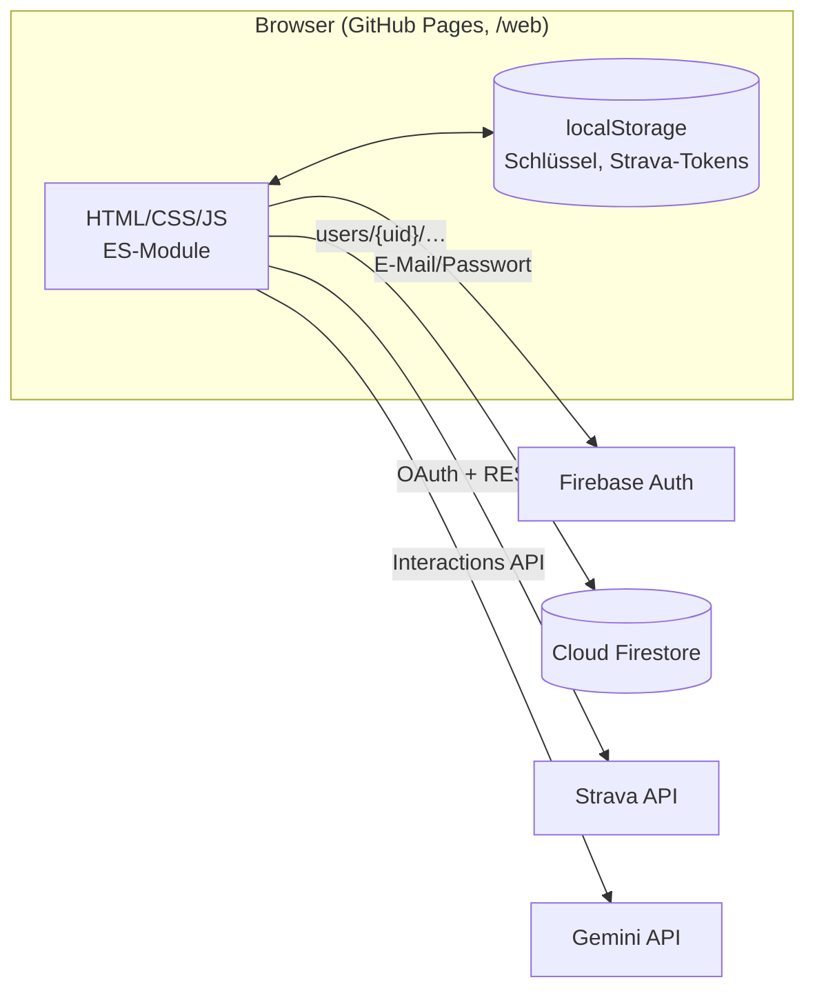

# TPA – persönlicher Trainingsplaner

Eine Web-App nur für mich: Sie verbindet sich mit Strava, analysiert meine Aktivitäten und lässt
mit der Gemini API (Google, kostenloser Tarif) Trainingsempfehlungen und einen Trainingsplan erstellen.

> **Stand:** Grundgerüst. Navigation, Login (E-Mail/Passwort) und die Einstellungsseite funktionieren,
> alles andere sind Platzhalter mit `TODO`-Kommentaren.

## Architektur



- **Frontend:** reines HTML, CSS und JavaScript mit ES-Modulen. Kein Framework, kein Build, kein npm.
  GitHub Pages liefert den Ordner `/web` 1:1 aus.
- **Firebase (Spark-Tarif, kostenlos):** Authentication (E-Mail/Passwort) und Cloud Firestore.
  Das SDK wird per CDN von `gstatic.com` mit fester Version (`13.2.0`) geladen.
- **Kein eigenes Backend:** Cloud Functions bräuchten den kostenpflichtigen Blaze-Tarif. Da die App
  nur von mir genutzt wird, werden Strava und Gemini direkt aus dem Browser angesprochen.
  Der Preis dafür: Geheimnisse müssen im Browser liegen (siehe Sicherheitshinweise).

### Dateien

| Pfad | Zweck |
| --- | --- |
| `web/index.html` | Einstieg, Navigation |
| `web/css/style.css` | schlichtes, responsives Layout |
| `web/js/app.js` | Hash-Router, Login-Status, Erkennung der Strava-Rückleitung |
| `web/js/firebase-config.js` | öffentliche Firebase-Konfiguration |
| `web/js/firebase.js` | Firebase-Initialisierung, Login/Logout |
| `web/js/settings.js` | Schlüssel in localStorage lesen, speichern, löschen |
| `web/js/secrets-sync.js` | Schlüssel zwischen localStorage und Firestore abgleichen |
| `web/js/strava.js` | Strava-OAuth, Token-Refresh, Aktivitäten laden |
| `web/js/analysis.js` | Trainingsanalyse (reine Berechnungen) |
| `web/js/hr-details.js` | HF-Streams nachladen, Histogramme speichern |
| `web/js/views/rating.js` | Kasten „Noch zu bewerten“ (Anstrengung/Notiz) |
| `web/js/plan-tracking.js` | Planerfüllung und Disziplin (reine Berechnungen) |
| `web/js/season.js` | Saisonplan: Wochenliste, Soll/Ist (reine Berechnungen) |
| `web/js/gemini.js` | Gerüst: Gemini Interactions API, Modell- und Prompt-Konstanten |
| `web/js/views/*.js` | je ein Modul pro Seite |
| `firestore.rules` | Security Rules zum Einfügen in der Firebase-Konsole |
| `.github/workflows/deploy-pages.yml` | Deployment von `/web` auf GitHub Pages |

### Seiten (Hash-Routing)

`#login` · `#verbinden` · `#aktivitaeten` · `#analyse` · `#plan` · `#einstellungen`

### Firestore-Datenmodell (geplant)

```
users/{uid}                           Profil & Ziele (Max-HF, Ruhepuls, Wettkampf)
users/{uid}/activities/{activityId}   normalisierte Strava-Aktivitäten
users/{uid}/analyses/{analysisId}     Auswertungen und KI-Empfehlungen
users/{uid}/plans/{planId}            Saisonpläne (Wochenziele bis zum Wettkampf)
users/{uid}/private/secrets           Strava Client ID/Secret, Gemini API-Key
```

Jeder Nutzer darf nur unter `users/{uid}/…` lesen und schreiben, alles andere ist gesperrt.

## Sicherheitshinweise

- **Niemals ins Repository:** Strava Client Secret, Strava Access-/Refresh-Tokens, Gemini-API-Key.
- Diese Werte werden auf der Seite **Einstellungen** eingegeben und im localStorage des Browsers
  gespeichert. Mit **„In Firebase speichern“** landen Strava Client ID, Strava Client Secret und
  Gemini API-Key zusätzlich in `users/{uid}/private/secrets`. Nach dem Login auf einem anderen
  Gerät holt die App fehlende Schlüssel automatisch von dort.
- Das Firestore-Dokument liegt **im Klartext** vor und ist nur durch Firebase-Login und
  `firestore.rules` geschützt (nur der Eigentümer darf lesen). Wer dein Login-Passwort kennt,
  kann die Schlüssel lesen → **starkes, eigenes Passwort** verwenden und die Selbstregistrierung
  in Firebase abschalten.
- Strava Access-/Refresh-Tokens bleiben nur im localStorage.
- Der Button **„Alle Schlüssel löschen“** entfernt die Schlüssel aus dem Browser und – wenn du
  angemeldet bist – auch aus Firebase. Die App am besten nur auf eigenen Geräten verwenden.
- localStorage ist für jedes Skript auf der Seite lesbar. Deshalb: keine fremden Skripte einbinden
  (außer dem Firebase-SDK mit fester Version), Nutzereingaben und API-Antworten nie als HTML
  einsetzen (`textContent` statt `innerHTML`).
- Das Strava Client Secret im Browser ist ein bewusster Kompromiss, weil es keinen Server gibt.
  Bei Verdacht auf Missbrauch das Secret in den Strava-API-Einstellungen neu erzeugen.
- Der Gemini-API-Key wird aus dem Browser verwendet. In der Google Cloud Console den Key
  **einschränken**: Anwendungseinschränkung „Websites“ (nur
  `https://jakobschiller34-jpg.github.io/*` und `http://localhost:*/*`) und
  API-Einschränkung nur „Generative Language API“.
- **Kostenloser Gemini-Tarif:** Google darf Eingaben und Antworten zur Produktverbesserung nutzen.
  Deshalb nur kompakte, anonymisierte Trainingszusammenfassungen senden (keine Namen, Orte,
  GPS-Spuren). Für das Projekt des Keys **keine Abrechnung aktivieren**, sonst wird es kostenpflichtig.
- Die Firebase-Web-Konfiguration (`apiKey`, `projectId` …) ist öffentlich und darf ins Repository.
  Geschützt werden die Daten durch Login und `firestore.rules`.

## Einrichtung Schritt für Schritt

Die App läuft später unter `https://jakobschiller34-jpg.github.io/TPA-Schiller/`.

### 1. Firebase-Projekt anlegen

1. In der [Firebase-Konsole](https://console.firebase.google.com/) ein neues Projekt anlegen
   (Google Analytics wird nicht benötigt). Tarif: **Spark** (kostenlos).
2. **Authentication → Sign-in method → E-Mail-Adresse/Passwort** aktivieren
   (nur die erste Option, „E-Mail-Link“ wird nicht benötigt).
   Dann unter **Authentication → Users → Nutzer hinzufügen** das eigene Konto mit E-Mail und
   Passwort anlegen. Eine Registrierung in der App gibt es bewusst nicht.
   Empfehlung: **Authentication → Einstellungen → Nutzeraktionen** → „Erstellen (Registrierung)
   aktivieren“ ausschalten, damit sich niemand sonst über die API ein Konto anlegen kann.
3. **Authentication → Einstellungen → Autorisierte Domains:**
   `jakobschiller34-jpg.github.io` hinzufügen. `localhost` ist standardmäßig eingetragen.
   (Hinweis: `127.0.0.1` ist nicht automatisch dabei – lokal also `localhost` verwenden
   oder `127.0.0.1` zusätzlich eintragen.)
4. **Firestore Database → Datenbank erstellen**, Modus „Produktion“, Standort z. B.
   `eur3` oder `europe-west3` (der Standort lässt sich später nicht ändern).
5. **Projekteinstellungen → Allgemein → Meine Apps → Web-App hinzufügen** (ohne Firebase Hosting)
   und die angezeigten Werte in `web/js/firebase-config.js` eintragen.

### 2. Security Rules einfügen

Firestore Database → **Regeln** → den Inhalt von [`firestore.rules`](firestore.rules) einfügen →
**Veröffentlichen**.

### 3. Strava-API-App anlegen

1. Unter <https://www.strava.com/settings/api> eine App anlegen.
2. **Authorization Callback Domain:** `jakobschiller34-jpg.github.io` (nur die Domain, ohne
   `https://` und ohne Pfad). `localhost` und `127.0.0.1` sind bei Strava
   immer erlaubt, lokale Tests funktionieren also ohne Umstellen. Als **Website** reicht
   `https://jakobschiller34-jpg.github.io/TPA-Schiller/` (nur Info-Feld).
3. **Client ID** und **Client Secret** notieren und später in der App unter
   **Einstellungen** eintragen – nicht im Code.

### 4. Gemini-API-Key erstellen (kostenlos)

1. In [Google AI Studio](https://aistudio.google.com/) mit einem Google-Konto anmelden und
   unter **Get API key** einen Key erstellen. Ein bestehendes Google-Cloud-Projekt
   (z. B. das Firebase-Projekt) oder ein neues kann gewählt werden. Abrechnung **nicht** aktivieren.
2. In der [Google Cloud Console](https://console.cloud.google.com/apis/credentials) den Key
   einschränken (siehe Sicherheitshinweise: Websites + nur „Generative Language API“).
3. Den Key in der App unter **Einstellungen** eintragen und „In Firebase speichern“ klicken.

Modelle: „Schnelle Analyse“ mit `gemini-3.5-flash-lite`, „Gründliche Analyse“ mit `gemini-3.8-flash`
(mittlere Denktiefe, bis 5 Min.) – konfiguriert in `ANALYSIS_MODES` in `web/js/gemini.js`. Der kostenlose
Tarif hat Anfrage-Kontingente pro Minute und Tag – für eine Person reicht das.

### 5. GitHub Pages aktivieren

1. Repository → **Settings → Pages → Build and deployment → Source: „GitHub Actions“**.
2. Nach einem Push auf `main` läuft der Workflow `Deploy to GitHub Pages` und veröffentlicht `/web`.
   Er lässt sich auch manuell unter **Actions** starten.

### 6. Lokal testen

Die App braucht einen statischen Webserver (ES-Module funktionieren nicht über `file://`):

- **VS Code:** Erweiterung „Live Server“ installieren, `web/index.html` öffnen →
  „Open with Live Server“. Im Browser `localhost` statt `127.0.0.1` verwenden (siehe Schritt 1).
- **Alternativ mit Python:** im Ordner `web` `python -m http.server 8000` ausführen und
  <http://localhost:8000/> öffnen.

Ohne eingetragene Firebase-Konfiguration lässt sich trotzdem navigieren; die Login-Seite zeigt dann
den Hinweis „Firebase ist noch nicht konfiguriert“.

## Offene Punkte und nächste Ausbaustufen

1. ~~CORS-Test Strava-Token-Tausch~~ – **erledigt (2026-11-19):** `POST /oauth/token` und
   `/api/v3/...` antworten mit `access-control-allow-origin: *`. Token-Tausch, Refresh und
   Aktivitäten-Abruf funktionieren direkt aus dem Browser, ein Backend ist nicht nötig.
2. ~~Strava-OAuth~~ – **umgesetzt:** Verbinden/Trennen, `state`- und Scope-Prüfung, Token-Refresh
   (`getValidAccessToken()`). Tokens nur im localStorage – pro Gerät/Domain einmal verbinden.
3. ~~Aktivitäten-Import~~ – **umgesetzt:** Erstimport der letzten 12 Monate, danach nur neue
   Aktivitäten; seitenweise (200 pro Seite), ohne GPS-Daten, gespeichert in
   `users/{uid}/activities/{stravaId}`. Bei Strava-Limit (429) Hinweis statt Abbruchschleife.
4. Offen: ältere Aktivitäten nachladen, Aktivitäten bei Änderungen in Strava aktualisieren.
5. ~~Analyse~~ – **umgesetzt** (`web/js/analysis.js`, Fokus Laufen + Rad): Wochenumfang
   (12 Wochen), HF-Zonen aus Max-HF bzw. HF-Reserve, Belastung akut/chronisch
   (Minuten × Zone), Trend 4 vs. 4 Wochen, Wettkampf-Countdown. Profil & Ziele in `users/{uid}`.
   **HF-Streams umgesetzt** (`web/js/hr-details.js`): pro Aktivität wird der Strava-Stream
   geladen und nur ein HF-Histogramm (Sekunden pro 5-bpm-Bereich) gespeichert. Zonen und
   Belastung werden daraus zeitanteilig berechnet, sonst über die Ø-HF. Nachladen in Portionen
   (80 Anfragen) wegen des Strava-Limits (~100 / 15 Min.).
6. ~~Gemini-Anbindung~~ – **umgesetzt:** Button „Empfehlung von Gemini holen“ auf der Analyse-Seite.
   Gesendet wird nur `summaryForAi()` (anonym, ~3 KB). Antwort als JSON nach festem Schema
   (Einschätzung, Stärken, Risiken, 7 Tage Einheiten, Schwerpunkt), im Browser geprüft und in
   `users/{uid}/analyses` gespeichert. Hinweis: Der Header `Api-Revision` wird weggelassen, da
   Googles CORS-Preflight ihn ablehnt.
7. ~~Feedback & erweiterbarer Plan~~ – **umgesetzt:** Kasten „Noch zu bewerten“ (RPE 1–10 +
   optionale Notiz, gespeichert im Aktivitäts-Dokument). RPE und Notizen der letzten 14 Tage gehen
   an Gemini (Notizen bewusst mit Einverständnis). Empfehlung mit Kerneinheit + optionalem Zusatz
   pro Tag und Wochen-Spielraum für Extras.
8. ~~Plan abhaken & Disziplin~~ – **umgesetzt** (`web/js/plan-tracking.js`, Seite „Trainingsplan“):
   Plantage werden automatisch mit importierten Aktivitäten abgeglichen (Sportart, ≥ 70 % Dauer;
   Ruhetage, Extras), manuell per ✓/✗ überstimmbar (`checks` im Analyse-Dokument). Disziplin-Quote
   für den aktuellen Plan und die letzten 4 Wochen (neuerer Plan gilt ab seinem ersten Tag).
9. ~~Saisonplan~~ – **umgesetzt** (`web/js/season.js`, Seite „Trainingsplan“): Gemini plant alle Wochen
   bis zum Laufwettkampf (Phasen, Lauf-km, langer Lauf, Rad-Stunden, Schlüsseleinheiten,
   Entlastungswochen; max. 30 Wochen), gespeichert in `users/{uid}/plans`. Soll/Ist und Erfüllung
   pro Woche, Saison-Quote. Die 7-Tage-Empfehlung richtet sich nach den aktuellen Wochenzielen.
11. ~~Ein Plan, neues Design~~ – **umgesetzt:** Geplant wird nur noch auf der Seite „Trainingsplan“
    (Saisonplan → Wochenziele → Tagesplan; „Saisonplan erstellen“ legt den Tagesplan automatisch an).
    Die Analyse-Seite zeigt nur Zahlen und die Gemini-Einschätzung. „Deep Blue“-Design mit Dark Mode,
    Schriften Inter/Space Grotesk über Google Fonts.
10. ~~Login-Sperre~~ – **umgesetzt:** ohne Anmeldung leitet jede Seite auf `#login` um; nach dem
    Login geht es zur ursprünglich gewünschten Seite zurück. Ohne Firebase-Konfiguration frei.
